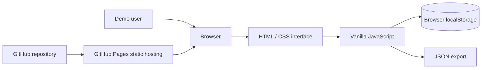

# Technical Documentation — Lub Dee Mai Look?

**Project:** Pediatric Obstructive Sleep Apnea (OSA) Screening Application  
**Implementation:** Static browser-based working prototype  
**Status:** Demo / portfolio; not validated for clinical use

## 1. Purpose and scope
The application demonstrates a structured workflow for recording pediatric OSA risk factors and reviewing assessment completeness. It is a data-entry and workflow prototype, **not** a diagnostic tool or a validated risk prediction model.

## 2. Architecture



**Important distinction:** The currently published repository contains a single-file static application (`index.html`). It does **not** contain a deployed Express API or a live PostgreSQL integration. Backend/database development is a separate proposed next phase.

## 3. Technology stack
| Layer | Technology | Purpose |
|---|---|---|
| UI | HTML5, CSS3 | Responsive Thai-language interface |
| Application logic | Vanilla JavaScript | Input handling, completeness checks, history |
| Demo storage | Browser localStorage | Local-only persistence on the same browser profile |
| Export | JSON / Blob API | Download synthetic records |
| Source control | Git / GitHub | Version history and documentation |
| Static deployment | GitHub Pages + Actions | Publish static files when Pages is enabled |

## 4. Main user workflow
1. Enter a synthetic project code and age in months.
2. Mark each of five risk factors as **Present**, **Absent**, or **Not assessed**.
3. Confirm that only synthetic data are being used.
4. Review completeness; it counts only Present or Absent answers.
5. Save a demo record in localStorage.
6. View or delete records, or export records to JSON.

No clinical score, risk category, diagnosis, or treatment recommendation is calculated.

## 5. Data structure
A demo record is stored as an object with the following fields:

| Field | Type | Meaning |
|---|---|---|
| `id` | string | Browser-generated record identifier |
| `childCode` | string | Synthetic demo code (not a patient identifier) |
| `ageMonths` | number | Age in months |
| `factors` | object | Five risk factor keys with present/absent/unknown values |
| `completeness` | number | Number of assessed factors, 0–5 |
| `createdAt` | ISO date-time string | Local record creation timestamp |
| `prototype` | boolean | Indicates demo record |

Factor keys: `tonsil`, `family`, `infection`, `obesity`, `adenoid`.

Storage key: `lubdeemaimailook_demo_assessments_v1`. localStorage is **not** suitable for identifiable pediatric health data.

## 6. Source files
- `index.html` — complete static UI, CSS, and JavaScript
- `README.md` — project overview and setup
- `SECURITY.md` — demo security/privacy limitations
- `docs/clinical-safety.md` — clinical limitations
- `docs/technical-documentation.md` — this document
- `docs/git-workflow.md` — Git and collaboration workflow
- `docs/testing-guide.md` — manual test scenarios
- `.github/workflows/pages.yml` — Pages deployment workflow

## 7. Local installation
Clone the repository:
```bash
git clone https://github.com/drsatanee-ent/lubdeemaimailook-frontend-backend.git
cd lubdeemaimailook-frontend-backend
```
Open `index.html` in a modern browser. No Node.js server or PostgreSQL installation is required for **this static version**.

## 8. Deployment
The repository has a GitHub Actions workflow at `.github/workflows/pages.yml`. In **Settings → Pages**, set **Source = GitHub Actions**, then run the workflow. A successful GitHub Actions run and a reachable Pages URL are required before describing the site as deployed.

Expected project URL after successful deployment:
`https://drsatanee-ent.github.io/lubdeemaimailook-frontend-backend/`

**Deployment is not established merely by having this workflow file.**

## 9. Known limitations
- No backend API, shared database, accounts, or user roles
- No secure server-side audit trail, patient consent workflow, or production security controls
- Local-only data; browser clearing or device changes can remove records
- No validated risk prediction or clinical decision support
- Literature OR values are context, not model coefficients

## 10. Future roadmap
Clinician review of factors and references → formal data dictionary → validated model → secure backend and role-based access → privacy/consent and audit controls → clinical and security validation.

See [Clinical safety](clinical-safety.md) and [Security notice](../SECURITY.md).
